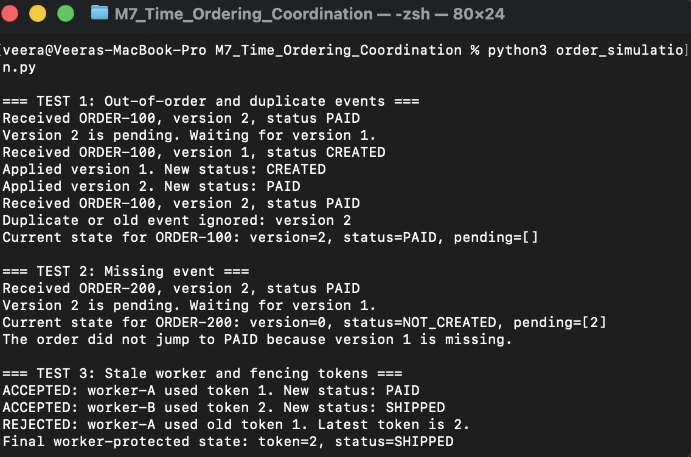

# Module 7 Assignment: Time, Ordering & Coordination

This is a small order processing simulation written in Python. In this project, one order moves through different states like this:

```
CREATED → PAID → SHIPPED
```

In a real distributed system, messages can come late, they can come in wrong order, or the same message can come two times. So I tried to make a program that can handle all these problems. I also added a fencing token part, so an old (stale) worker cannot overwrite the newer data.

## Files in this project

| File | What it is |
|------|------------|
| `order_simulation.py` | The main program, all 3 tests are in this file |
| `terminal_output.txt` | The output I got when I run the program |
| `screenshots/terminal_output.png` | Screenshot of the terminal output |
| `README.md` | This file |

## How to run the program

You only need Python 3. No extra library is needed, I used only the standard library.

1. Download or clone this repository.
2. Open terminal inside the project folder.
3. Run this command:

```bash
python3 order_simulation.py
```

(On Windows sometimes the command is `python order_simulation.py`.)

The program will run all three tests one by one and print the result in the terminal.

## How it works (short explanation)

Every event has three things: `order_id`, `version` and `status`.

For each order, the program remember the last applied version. When a new event come, it checks the version:

- **If version is the next expected one** → apply it, and after that also check if any pending events can now be applied.
- **If version is bigger than expected** → we are missing something in between, so the event is saved in a `pending` list and the program wait.
- **If version is smaller or same as already applied** → it is a duplicate or old event, so it is ignored.

For the stale worker part, the store keep the latest fencing token it has seen. If a worker come with a token that is older than the latest one, the update is rejected.

## Screenshot



## Test 1: Correct event ordering and duplicate handling

In this test I send the events in this order: version 2, then version 1, then version 2 again.

```
=== TEST 1: Out-of-order and duplicate events ===
Received ORDER-100, version 2, status PAID
Version 2 is pending. Waiting for version 1.
Received ORDER-100, version 1, status CREATED
Applied version 1. New status: CREATED
Applied version 2. New status: PAID
Received ORDER-100, version 2, status PAID
Duplicate or old event ignored: version 2
Current state for ORDER-100: version=2, status=PAID, pending=[]
```

What happened here:

- **Correct ordering:** Version 2 came first, but the program did not apply it, it put it in pending and waited for version 1. When version 1 came, it applied version 1 first (CREATED) and then version 2 (PAID) automatically. So the order is correct even though the messages came in wrong order.
- **Duplicate handling:** When version 2 came again, the program saw it was already applied, so it ignored it. The final state is still `version=2, status=PAID` and nothing was applied two times.

## Test 2: Missing event

In this test I only send version 2, and version 1 never comes.

```
=== TEST 2: Missing event ===
Received ORDER-200, version 2, status PAID
Version 2 is pending. Waiting for version 1.
Current state for ORDER-200: version=0, status=NOT_CREATED, pending=[2]
The order did not jump to PAID because version 1 is missing.
```

What happened here:

- The order **did not jump ahead** to PAID. It is still `NOT_CREATED` with version 0.
- The program **detected the missing version** and printed that it is waiting for version 1.
- Version 2 is **saved as pending** (`pending=[2]`), so if version 1 comes later, both will be applied in correct order.

## Test 3: Stale worker and fencing tokens

Here two workers try to update the same order. Each worker get an increasing fencing token. Worker A has token 1 and worker B has token 2.

```
=== TEST 3: Stale worker and fencing tokens ===
ACCEPTED: worker-A used token 1. New status: PAID
ACCEPTED: worker-B used token 2. New status: SHIPPED
REJECTED: worker-A used old token 1. Latest token is 2.
Final worker-protected state: token=2, status=SHIPPED
```

What happened here:

- Worker A first updated the order with token 1, that is fine.
- Then worker B got a newer token (2) and updated the order to SHIPPED. This was **accepted**.
- After that worker A came back (for example after a long pause) and tried to set CANCELLED with its old token 1. This was **rejected** because the latest token is 2.
- The final status stays `SHIPPED`, so the stale worker could not break the data.

## Reflection

**Why are timestamps alone not enough to guarantee correct event ordering in a distributed system?**

Every machine in a distributed system has its own clock, and these clocks are never perfectly same, they can drift or be a little bit fast or slow even with NTP. So one event that really happened later can get an earlier timestamp just because its machine clock was behind. Also, two events can have the same timestamp, and then we don't know which one is first. Timestamps also don't tell us if some event is missing in between, but with version numbers we can see the gap (like in my Test 2) and wait for it. Because of this, it is better to use things like version numbers, logical clocks or fencing tokens to decide the order, not only the wall clock time.
